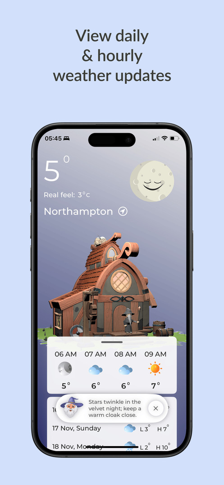
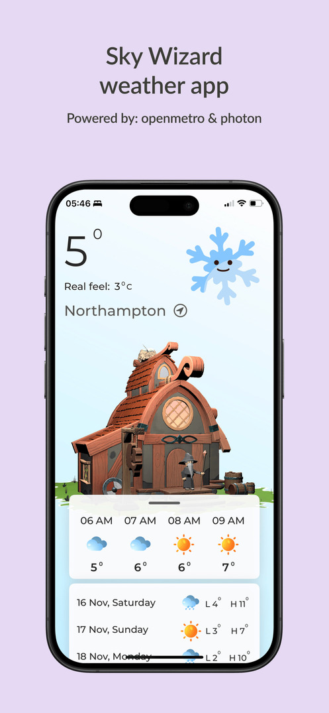
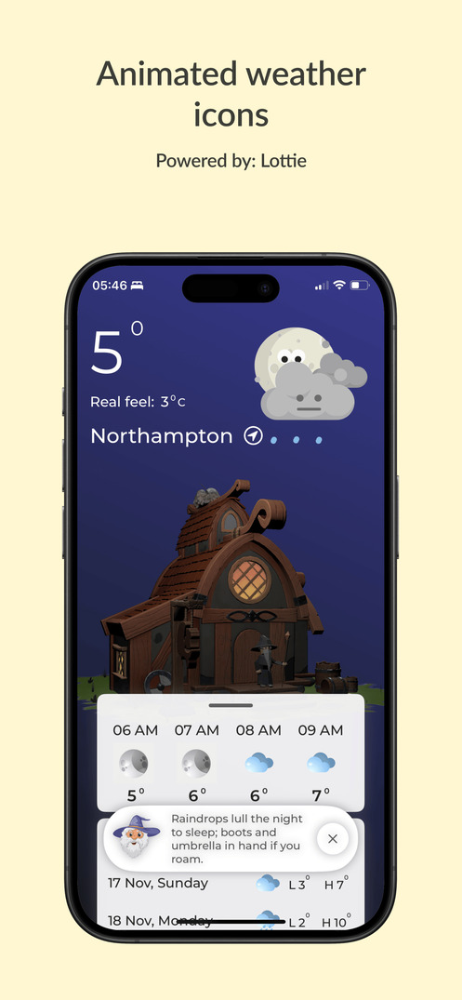
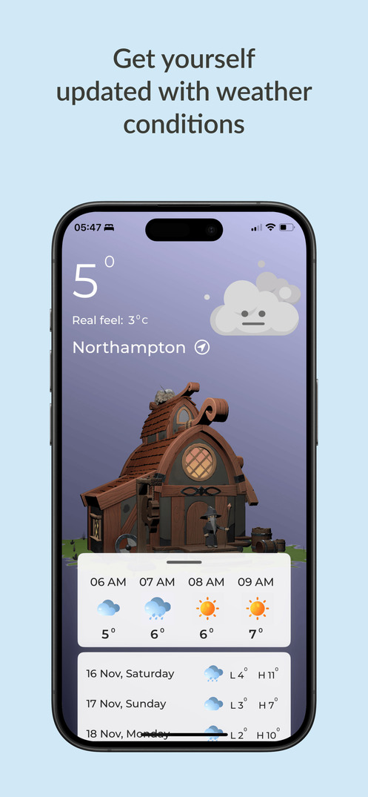
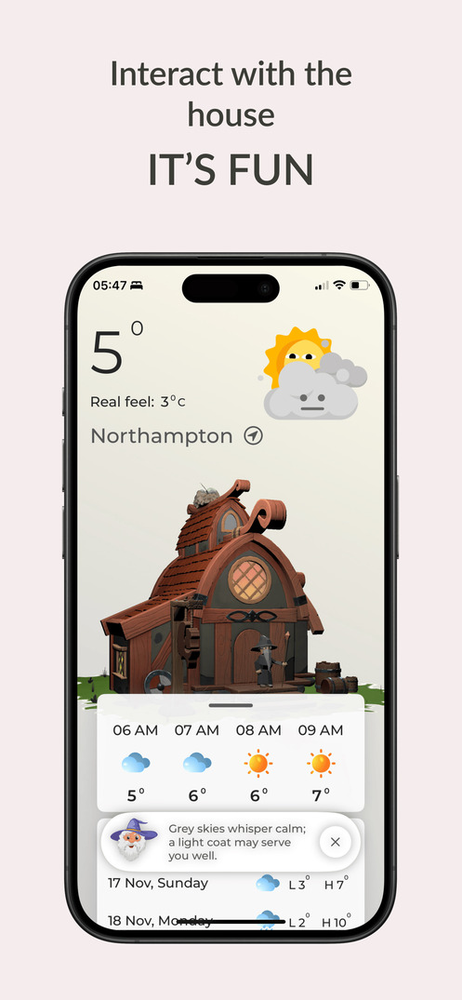
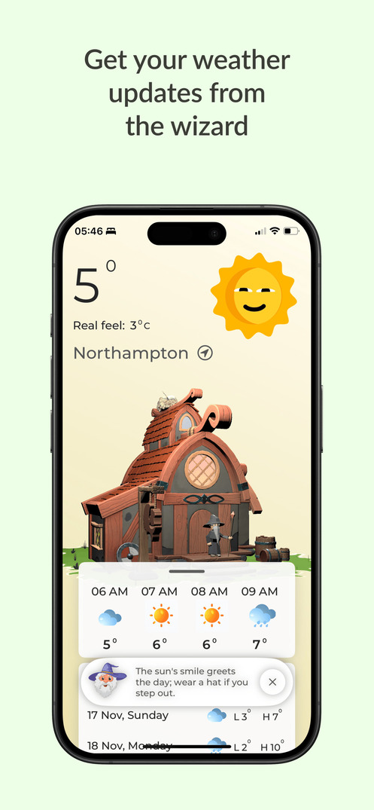
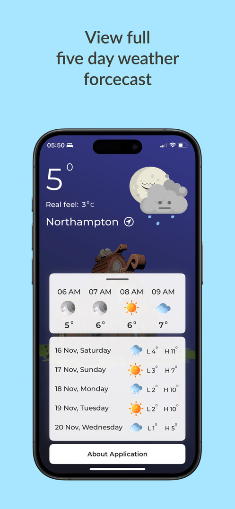
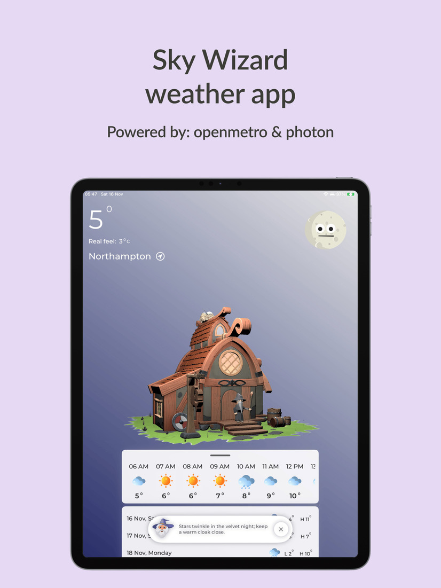
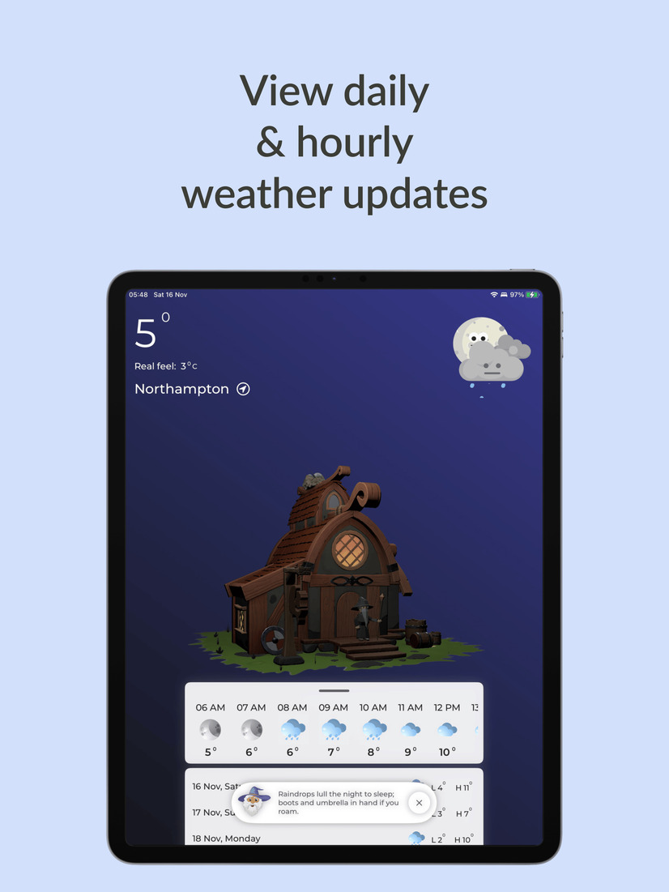

<div align="center">

# ☁️ SkyLoom

**Beautifully woven weather forecasts for iOS**

A clean, modern SwiftUI weather app — live forecasts, animated weather scenes, and a 3D home experience, powered by the free Open-Meteo API.

   

</div>

---

## 📱 Screenshots

<div align="center">

| | | |
|:---:|:---:|:---:|
|  |  |  |
|  |  |  |
|  |  |  |

</div>

## ✨ Features

- **Live weather** — current temperature, feels-like, hourly and 7-day forecasts
- **3D animated home scene** — a SceneKit `wizard house` that reacts to conditions
- **Lottie-style particle animations** — snow, night and dynamic weather overlays
- **Location aware** — GPS + geocoding search for any city worldwide
- **Custom design system** — Montserrat typography, glass morphism, dark & light
- **Offline handling** — reachability monitoring with graceful fallbacks
- **Tested** — unit tests for weather and geocoding services included

## 🌤️ No API Key Needed

SkyLoom runs on [Open-Meteo](https://open-meteo.com) — free, open and keyless. Clone and run, zero configuration.

## 🚀 Getting Started

```bash
git clone https://github.com/Awaisdev01/SkyLoom.git
cd SkyLoom
open SkyLoom.xcodeproj
```

1. Select the **SkyLoom** scheme and run on an iOS 16+ simulator or device
2. Allow location access (or search for a city) — that's it

### Project layout

```
SkyLoom/
├── SkyLoom/            # App target — SwiftUI views, assets, 3D scene, fonts
├── SkyLoom.xcodeproj   # Xcode project
├── SkyLoomAPI/         # Swift Package — models, enums, services, logger, tests
│   ├── SkyLoomModel    #   Weather / geocoding data models
│   ├── SkyLoomService  #   Weather, geocoding, location, reachability services
│   ├── SkyLoomEnum     #   Weather types & enums
│   └── SkyLoomLogger   #   Logging
└── banners/            # App Store screenshots (iPhone + iPad)
```

### Architecture

- **MVVM-ish SwiftUI** — `Presentation/` holds views and navigation, `Datastores/` state, `Application/` app lifecycle and dependencies
- **Swift Package separation** — all networking and models live in `SkyLoomAPI`, independently testable
- Protocol-driven services with mocks (`WeatherServiceMock`, `LocationServiceMock`)

## 🧪 Testing

```bash
cd SkyLoomAPI
swift test
```

## 📄 License

MIT — see [LICENSE](LICENSE).

---

## 📬 Contact

Open for work and business inquiries — **awaisdev5765@gmail.com**

<div align="center">

*Forecast woven beautifully* 🧵

</div>
